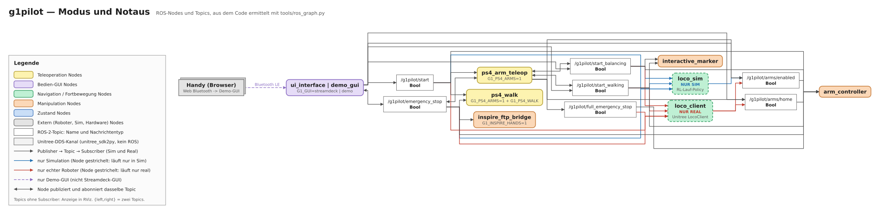
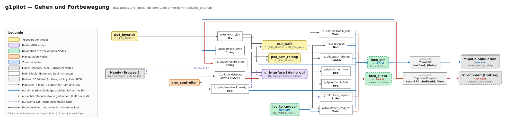
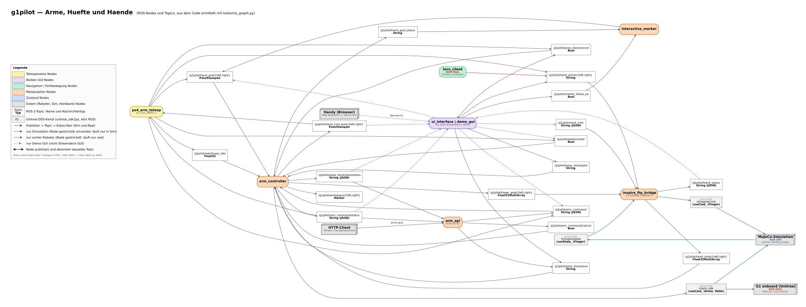
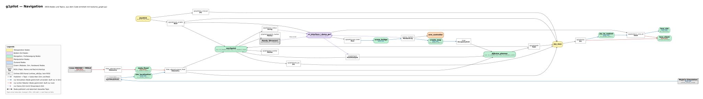
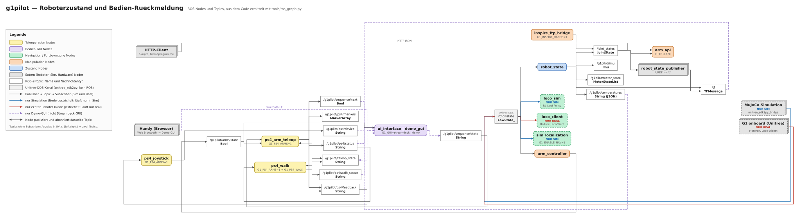

# Nodes und Topics — Technik

Richtet sich an Entwickler, die wissen wollen, welcher Node welches Topic
schreibt und liest, bevor sie einen Node ändern oder einen neuen anhängen.
Die Node-Liste mit Dateien steht in [02-T-Architektur.md](02-T-Architektur.md#projektstruktur--node-übersicht).

Die Diagramme sind aus dem Code ermittelt (`create_publisher`,
`create_subscription`, `ChannelPublisher`, `ChannelSubscriber` in
`g1pilot/g1pilot/`, Startbedingungen aus `launch/`) und werden mit
[`tools/ros_graph.py`](../tools/ros_graph.py) erzeugt.

## So liest man die Diagramme

- **Farbige, abgerundete Kästen** sind ROS-Nodes, die Farbe ist die
  Kategorie: Teleoperation (gelb), Bedien-GUI (lila), Navigation und
  Fortbewegung (grün), Manipulation (orange), Zustand (blau). Graue
  3D-Kästen sind Dinge außerhalb des g1pilot-Stacks (MuJoCo, der G1 selbst,
  Inspire-Hände, MOLA, Handy, HTTP-Clients).
- **Weiße Kästen** sind ROS-2-Topics mit Name und Nachrichtentyp, **hellgraue**
  sind Unitree-DDS-Kanäle (`rt/...`, über `unitree_sdk2py`, kein ROS).
- Pfeile laufen Publisher → Topic → Subscriber. Ein Doppelpfeil heißt: der
  Node publiziert und abonniert dasselbe Topic (z. B. `/g1pilot/teleop_state`).
- **Sim und Real:** blaue Pfeile gelten nur in der Simulation, rote nur am
  echten Roboter, schwarze in beiden. Nodes, die nur in einer Welt laufen,
  sind gestrichelt umrandet und mit NUR SIM bzw. NUR REAL markiert.
- **Lila gestrichelt** heißt: nur die Demo-GUI (`G1_GUI=demo`) nutzt das
  Topic, die Streamdeck-GUI nicht. Beide GUIs stehen als ein Kasten
  `ui_interface | demo_gui`, weil immer nur eine läuft und die Demo-GUI
  alle Topics der Streamdeck-GUI erbt (`DemoNode(StreamDeck)`).
- `{left,right}` steht für zwei gleich aufgebaute Topics je Seite.
  Topics ohne Subscriber sind Anzeigen für RViz.

## Ansichten

Alle Topics in einem Bild wären nicht lesbar (über 70 Topics, mehr als
200 Kanten). Darum gibt es fünf Ansichten nach Thema; jede zeigt nur ihre
Topics und die Nodes, die daran hängen.

### Modus und Notaus

START, GREIFEN (`start_balancing`), GEHEN (`start_walking`), NOT-HALT und
Voll-Notaus, Arme aktivieren und in die Ausgangsposition fahren.



### Gehen und Fortbewegung

Geh-Befehle aus GUI und Controller, Rückmeldung des Lauf-Zustands, Freigabe
der Arme und der Hüfte fürs Gehen, Beinbefehle (Sim) und Loco-RPC (Real).



### Arme, Hüfte und Hände

Arm-Ziele, Posen und Abläufe, Arm-API, Hüftdrehung, Inspire-Hände und die
Arm-Befehle an den Roboter (`rt/arm_sdk`).



### Navigation

Joy-Mux (manuell/automatisch), Planer, Pfadfolger, Karte und Lokalisierung.
In der Sim ersetzen `sim_localization` und `create_map` die LiDAR-Kette
MOLA → `mola_fixed` des echten Roboters.



### Roboterzustand und Bedien-Rückmeldung

`rt/lowstate` → `/joint_states`, IMU, Temperaturen; Statusmeldungen
zwischen Controller und Demo-GUI (gemeinsamer Zustand, Abläufe).



### Gesamtbild

Alle Topics in einem Bild, nur zum Nachschlagen per Suche im Browser:
[images/ros_graph_gesamt.svg](images/ros_graph_gesamt.svg).

## Was wann läuft

| Node | Sim | Real | Bedingung |
|---|---|---|---|
| `robot_state`, `arm_controller`, `interactive_marker`, `arm_api`, `joy_mux` | ja | ja | immer |
| `ui_interface` bzw. `demo_gui` | ja | ja | `G1_GUI=streamdeck` / `demo` |
| `joystick` | ja | ja | ohne `G1_PS4_ARMS` |
| `ps4_joystick`, `ps4_arm_teleop` | ja | ja | `G1_PS4_ARMS=1` |
| `ps4_walk` | ja | ja | `G1_PS4_ARMS=1` und `G1_PS4_WALK` (Default an) |
| `inspire_ftp_bridge` | DDS zur MuJoCo-Hand | Modbus TCP zu den Händen | `G1_INSPIRE_HANDS=1` |
| `loco_sim`, `scene_bridge` | ja | — | immer in Sim |
| `sim_localization`, `create_map`, `joy_to_cmdvel` | ja | — | `G1_ENABLE_NAV=1` |
| `loco_client` | — | ja | immer am echten Roboter |
| `mola_fixed` (+ Livox, MOLA) | — | ja | `G1_ENABLE_LIDAR=1` |
| `dijkstra_planner`, `nav2point` | ja | ja | Sim `G1_ENABLE_NAV=1`, Real `G1_ENABLE_LIDAR=1` |

Zwei Auffälligkeiten aus dem Code: Am echten Roboter startet `bringup_real`
keinen Node, der `/map` publiziert (`create_map` läuft nur in der Sim), der
`dijkstra_planner` hat dort also keine Karte aus dem g1pilot-Stack (siehe
[31-T-Navigation.md](31-T-Navigation.md)). `/g1pilot/catch_falls` publiziert
die Streamdeck-GUI, im Stack liest es derzeit kein Node.

## Diagramme neu erzeugen

Nach jeder Änderung an Publishern oder Subscribern:

```bash
python3 tools/ros_graph.py --check   # nur prüfen, braucht nichts außer Python
python3 tools/ros_graph.py           # prüfen + SVGs nach docs/images/ schreiben
```

Das Skript zeichnet ohne Graphviz mit einem eigenen Layout: Jeder Node hat
eine Stufe (`TIER`, Eingaben links, Roboter und Sim rechts). Je Ansicht
verschiebt das Skript die Nodes so, dass möglichst wenige Linien rückwärts
laufen, setzt jedes Topic zwischen Publisher und Subscriber und zieht alle
Linien rechtwinklig. Rückmeldungen nach links laufen als Umweg über oder unter
dem Bild.

Die Tabellen `NODES`, `TOPICS`, `TIER` und `VIEWS` oben im Skript sind von Hand
gepflegt. `--check` vergleicht sie mit dem Code: jedes eingetragene Topic
muss im Code stehen, und jedes Topic aus einem `create_publisher`- oder
`create_subscription`-Aufruf (auch über Konstanten wie `WAIST_STATE_TOPIC`)
muss eingetragen und einer Ansicht zugeordnet sein. Topics, die nur als
ROS-Parameter-Default vorkommen (`joy_mux`, `nav2point`, `dijkstra_planner`
…), und wer welches Topic nutzt, prüft das Skript nicht; das muss man beim
Eintragen selbst nachsehen.
