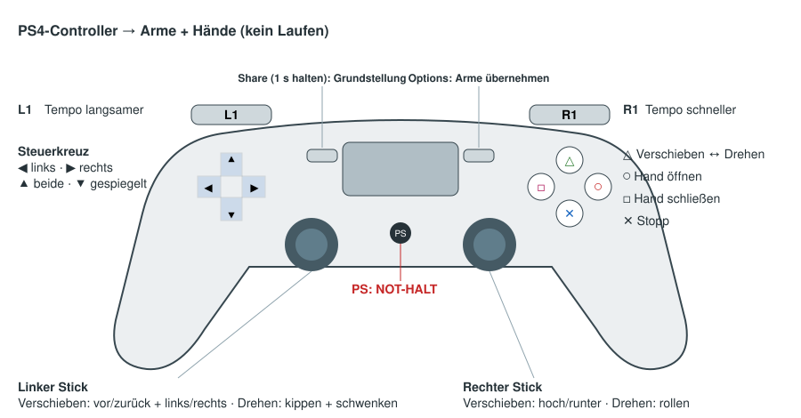
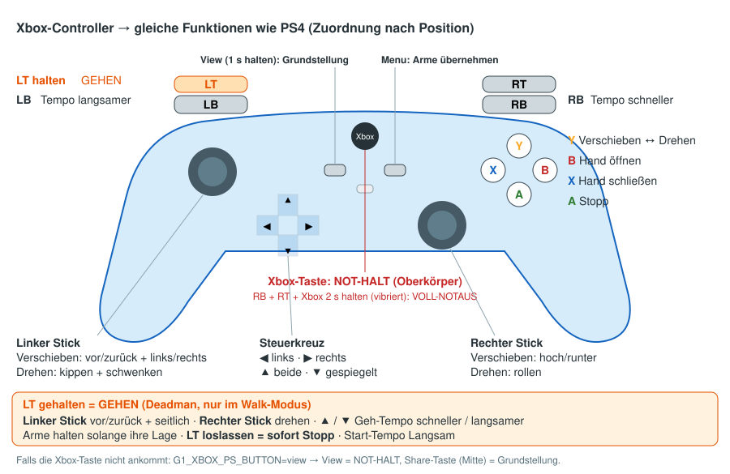

# PS4-Controller für den Oberkörper (Arme + Hände) und Gehen

Ein PS4-Controller (DualShock 4) steuert die Hände des G1: Position und
Drehung beider Hände, Hände auf/zu, Grundstellung, Stopp und NOT-HALT.
**L2 drücken** schaltet in den Modus **GEHEN**, **R2 drücken** in den
Modus **GREIFEN** (wie die Kacheln der Demo-GUI). Gelaufen wird nur, solange
**L2 gehalten** wird (Totmann); losgelassen bleibt GEHEN, die Arme sind am
Controller dann gesperrt — siehe [GEHEN und GREIFEN](#gehen-und-greifen-l2--r2).
Am echten G1 schaltet der Controller die Beine nie selbst um (Damp,
Preparation, Walk bleiben in der GUI).

Statt des PS4-Controllers geht auch ein **Xbox-Controller** (Xbox One /
Series, z. B. „Shock Blue“) mit denselben Funktionen auf denselben
Positionen, siehe [Xbox-Controller](#xbox-controller). Er wird automatisch
erkannt.

Funktioniert in der **Simulation und am echten Roboter** (Unterschiede am
echten Roboter: siehe [Echter Roboter](#echter-roboter)). Ohne den Schalter
bleibt alles wie bisher — am echten Roboter steuert der Controller dann wie
gehabt das Gehen (Deadman, `loco_client`).

## Starten

| | Startmenü (GUI) | Text-Menü (`start.sh`) | ohne Menü |
|---|---|---|---|
| Sim | Simulation → Ausstattung → **PS4-Controller** | *3c) PS4-Controller für Arme + Hände?* → Ja | `G1_PS4_ARMS=1 ./start.sh --yes` |
| Real | Echter Roboter → Ausstattung → **PS4-Controller für Arme + Hände** | *R3c) PS4-Controller steuert …* → Arme + Hände | `G1_MODE=real G1_PS4_ARMS=1 ROBOT_INTERFACE=… G1_REAL_CONFIRM=1 ./start.sh --yes` |

Den Controller per Bluetooth koppeln oder per USB anstecken — vor oder nach
dem Start, auch ein kurzer Funkabriss ist kein Problem (er verbindet sich
selbst neu). In der Sim zuerst **Options** drücken: der Roboter steht und
die Arme gehören dem Controller (wie die Kachel GREIFEN in der Demo-GUI).
Am echten Roboter erst in der GUI starten, siehe unten.

## Belegung



| Taste | Wirkung |
|---|---|
| Steuerkreuz ← | **linke** Hand wählen (LED gelb; blau ist GEHEN) |
| Steuerkreuz → | **rechte** Hand wählen (LED grün, Standard) |
| Steuerkreuz ↑ | **beide** Hände, parallel (LED violett) — z. B. eine Kiste tragen |
| Steuerkreuz ↓ | **beide gespiegelt** (LED türkis): links/rechts und Drehungen spiegelbildlich, Bezug ist die rechte Hand — z. B. Hände auseinander/zueinander |
| Dreieck | Umschalten **VERSCHIEBEN ↔ DREHEN**. Beim Wechsel zu VERSCHIEBEN vibriert der Controller kurz, beim Wechsel zu DREHEN nicht — so ohne GUI unterscheidbar. Beim Drehen leuchtet die LED zusätzlich gedimmt |
| Linker Stick | VERSCHIEBEN: vor/zurück + links/rechts · DREHEN: kippen (Finger hoch/runter) + schwenken. Rastet auf die Achse ein (bis 20° daneben zählt nur die Hauptrichtung), erst echt schräg fahren beide Achsen |
| Rechter Stick | VERSCHIEBEN: hoch/runter (vertikal) · DREHEN: rollen (horizontal) |
| L1 / R1 | Tempo langsamer / schneller: Langsam 5 cm/s · Normal 15 cm/s · Schnell 30 cm/s (Drehen 20 / 45 / 90 °/s). Start: Sim **Normal**, Real **Langsam** (höchstens Normal). Im Modus GEHEN bzw. mit gehaltenem L2: **Geh-Tempo** (siehe [Gehen mit L2](#gehen-mit-l2)) |
| Kreis | gewählte Hand(e) **öffnen** |
| Viereck | gewählte Hand(e) **schließen** |
| Kreuz | **Stopp**: Hand hält sofort an, eine laufende geplante Bewegung (Grundstellung, Ablauf) wird abgebrochen |
| Options | **Arme übernehmen**. Sim zusätzlich Greifen-Modus (stehen), wie die Kachel GREIFEN; Real nur die Arme |
| Share **1 s halten** | Grundstellung (Arme neben den Körper, geplant um Hindernisse herum) |
| PS | **NOT-HALT** (wie in den GUIs: Arme schlaff, Roboter gedämpft — real sackt er zusammen) |
| **R1 + L1 + PS 2 s halten** | **VOLL-NOTAUS**: ganzer G1 in Damp, auch die Beine. Controller vibriert während des Haltens, vorzeitig loslassen bricht ab. Siehe [Voll-Notaus](#voll-notaus-r1--l1--ps) |
| **L2 drücken** | Modus **GEHEN** (LED blau wie die GUI-Kachel GEHEN): Arm-Tasten und Sticks gesperrt, bis R2/Options; L1/R1 = Geh-Tempo |
| **L2 halten** | **Gehen** (Totmann): Sticks, L1/R1 und Steuerkreuz ▲/▼ gehören dem Gehen, siehe [Gehen mit L2](#gehen-mit-l2) |
| **R2 drücken** | Modus **GREIFEN**: Arme übernehmen (wie Options), Arm-Steuerung wieder frei |
| L3, R3, Touchpad | frei (Reserve) |

Richtungen gelten **aus Sicht des Roboters** (vor = in Blickrichtung des
Roboters, links = Roboter-links). Steht man dem Roboter gegenüber, sind
links/rechts also vertauscht.

Loslassen = Hand steht. Die Hand läuft dem Stick höchstens ein kleines Stück
voraus (wie in der Demo-GUI); kommt der Arm nicht weiter (Gelenkgrenze,
Kollisions-Gate vor Körper/Tisch), wandert das Ziel nicht davon. Wie schnell
die Hand reagiert und wie weit sie nachläuft, hängt vom Regeltakt des
arm_controllers ab, siehe [Reaktionszeit](#reaktionszeit).

**Rückmeldung**, welche Hand aktiv ist:
- Controller-LED in der Farbe der Auswahl (siehe Tabelle), rot bei NOT-HALT,
- kurze Vibration bei jedem Umschalten, lange bei NOT-HALT,
- in RViz eine farbige Kugel an der aktiven Hand, Display „PS4-Controller“
  (kein Text über dem Roboter, der stand im Weg; den vollen Status
  `PS4 · RECHTS · Verschieben · Normal` zeigt `ros2 topic echo /g1pilot/ps4/status`).

Hände öffnen/schließen wirkt mit **Inspire-Händen**; mit den starren Händen
passiert dabei nichts.

## GEHEN und GREIFEN (L2 / R2)

Seit 2026-10-19. Die beiden Trigger schalten den Modus wie die Kacheln
GEHEN und GREIFEN der Demo-GUI:

- **L2 drücken** → Modus **GEHEN** (`/g1pilot/start_walking`, einmal je
  Wechsel). L2 **gedrückt halten** = laufen (Totmann, siehe unten).
  **L2 loslassen** = sofort Stopp, der Modus **bleibt GEHEN**: Sticks,
  Steuerkreuz, Dreieck, L1/R1, Kreis/Viereck und Share wirken dann **nicht**
  auf die Arme (LED blau, Demo-GUI „PS4: GEHEN – L2 halten = laufen“).
  Es wirken nur Kreuz (Stopp), PS (NOT-HALT), der Voll-Notaus, L2 (laufen),
  L1/R1 (Geh-Tempo) und R2/Options (zurück zu GREIFEN).
- **R2 drücken** → Modus **GREIFEN**: Arme übernehmen (wie Options) und
  `/g1pilot/start_balancing` (Gehen aus, Roboter steht). Die Arm-Steuerung
  ist wieder frei.
- Wählt man GEHEN/GREIFEN in der Demo-GUI oder am Streamdeck, folgt der
  Controller (Sperre an/aus).
- Die Trigger sind analog: gedrückt ab halbem Weg, losgelassen erst unter
  30 % (kein Flattern).
- **Echter G1:** Beide Wechsel senden ihr Beine-Topic nur, wenn der G1 laut
  `/g1pilot/onboard_state` **schon im Walk-Modus** steht (FSM 500/501).
  Sonst bleibt der Modus, wie er ist, L2 vibriert lang und das Log sagt
  „GEHEN gesperrt – G1 steht nicht im Walk-Modus“; R2 übernimmt dann nur
  die Arme. `start_walking` würde den G1 sonst aus Preparation aufstellen.
  Im Walk bleiben die Arme beim Wechsel nach GEHEN, wo sie sind (wie bei
  der Kachel GEHEN, siehe PR #10); in der Sim fahren sie je nach
  Lauf-Policy erst in die Lauf-Pose.
- Abschalten: `G1_PS4_WALK=0` (dann weder L2 noch R2).

## Controller und Demo-GUI gekoppelt

Seit 2026-10-20. Controller und Demo-GUI haben **einen gemeinsamen
Bedienzustand** (`/g1pilot/teleop_state`, `teleoperation/shared_state.py`):
was auf einer Seite gewählt wird, zeigt die andere sofort.

| Was | am Controller | in der Demo-GUI |
|---|---|---|
| Modus GEHEN / GREIFEN | L2 / R2 (im GEHEN auch Options) | Kacheln GEHEN / GREIFEN |
| Hand-Auswahl | Steuerkreuz ◀ ▶ ▲ ▼ | GREIFEN → Hand bewegen: Links / Rechts / Beide / **Gespiegelt** |
| Tempo »Hand bewegen« | L1 / R1 | Tempo Langsam / Normal / Schnell |
| Geh-Tempo | im GEHEN L1 / R1 (auch L2 halten + ▲ / ▼) | GEHEN → Tempo Langsam / Normal (Schnell nur Anzeige) |

- **Nur Anzeige und Einstellung, keine neuen Fahrbefehle.** Wer den Modus
  wechselt, sendet wie bisher `start_walking` / `start_balancing` /
  `arms/enabled`; die andere Seite zieht nur die Anzeige nach. Wechselt der
  Controller auf GEHEN, zeigt die Kachel »wechselt …«, bis die Arme in der
  Lauf-Pose sind (`arms/walk_ready`), wie beim Antippen der Kachel.
- **Sicherheit unverändert:** Totmann (L2), NOT-HALT, Voll-Notaus und
  „Real-GEHEN nur, wenn der G1 schon im Walk steht“ bleiben, wie sie waren.
  Lehnt der Controller L2 ab (real, G1 nicht im Walk), erfährt die GUI auch
  kein GEHEN. Vor »Start« (real) übernimmt die GUI keinen Modus vom
  Controller, sie zeigt nur einen Hinweis.
- **Tempo-Grenzen bleiben je Seite:** Schnell in der GUI → der Controller
  fährt real höchstens Normal (`ps4_max_speed`). Geh-Tempo Schnell gibt es nur am Controller; die GUI zeigt
  es an, geht selbst aber höchstens mit Normal (wie bisher gedeckelt).
- **Startwerte:** beim Start gelten die Parameter der Controller-Nodes
  (real: Hand-Tempo Langsam, Geh-Tempo Langsam) auch in der GUI. Die GUI
  real startet damit bei »Hand bewegen« mit Langsam statt Normal. Ohne
  Controller (`G1_PS4_ARMS=0`) bleibt alles wie bisher.
- **Controller in der GUI:** keine eigene Info-Zeile mehr (Modus, Hand und
  Tempo zeigt die GUI selbst). Solange ein Controller aktiv ist, steht oben
  rechts *🎮 Belegung* (Name im Tooltip, bei Xbox mit Tasten-Zuordnung).
- Zeitstempel je Feld, der neueste gewinnt. Ein alter Modus (vor dem Start
  des jeweiligen Programms gewählt) wird nicht übernommen.

## Gehen mit L2

| Mit **L2 gehalten** | Wirkung |
|---|---|
| Linker Stick | **vor/zurück** + **seitlich** gehen |
| Rechter Stick (horizontal) | **drehen** (links/rechts) |
| R1 / L1 oder Steuerkreuz ▲ / ▼ | Geh-Tempo schneller / langsamer (R1/L1 auch ohne L2, solange Modus GEHEN): Langsam 35 % · Normal 65 % · Schnell 100 % der Geh-Limits (`G1_MAX_VX` 0,4 m/s, `G1_MAX_VY` 0,3 m/s, `G1_MAX_VYAW` 0,4 rad/s). Start **Langsam** (kurze Vibration je Stufe) |
| L2 loslassen | **sofort Stopp** |

- L2 schaltet zugleich in den Modus GEHEN (siehe oben): die Arme halten
  ihre Lage und sind am Controller gesperrt, auch nach dem Loslassen.
- Gehen nur, wenn der G1 **schon im Walk-Modus** steht (Real: Startleiste
  »Walk« der Demo-GUI bzw. Handy-App; Sim: GEHEN/WALK). Sonst passiert
  nichts — L2 vibriert dann einmal lang und das Log sagt
  „G1 steht nicht im Walk-Modus“.
- Der Controller schaltet Damp/Preparation/Walk **nie** selbst um.
- Erst **scharf nach einmal Loslassen**: wird L2 beim Start, nach einem
  Funkabriss oder nach einem NOT-HALT noch gehalten, läuft der G1 nicht los.
- NOT-HALT (PS oder GUI) sperrt auch das Gehen, bis quittiert ist.
- Abriss: kommt 0,3 s kein Joy (Funkabriss, Stall-Erkennung), sendet
  `ps4_walk` einmal Stopp; `loco_client` stoppt zusätzlich selbst nach 0,5 s
  ohne Befehl, und jedes `Move()` gilt am Roboter nur 1 s.
- Abschalten: `G1_PS4_WALK=0` (L2 wieder ohne Wirkung).

## NOT-HALT und Quittieren

PS löst den NOT-HALT aus — derselbe wie der Knopf in Demo-GUI und Streamdeck.
Die GUIs zeigen ihn dann auch an (Demo-GUI: Modus aus, real erscheint wieder
»Start«; Streamdeck: alle Knöpfe aus, EMERGENCY rot). Umgekehrt
sperrt ein NOT-HALT aus der GUI auch den Controller (LED rot).

Danach ignoriert der Controller alles außer PS, bis quittiert ist: Sim in
der Demo-GUI einen Modus wählen, Real »Start« bzw. Streamdeck
START. Das Quittieren liegt absichtlich nicht auf dem Controller: in der Sim
setzt START den Roboter auch zurück, real schaltet es den Roboter in Standby.

## Voll-Notaus (R1 + L1 + PS)

Zusätzlich zum NOT-HALT (PS allein, Oberkörper) gibt es einen **kompletten
Notaus für den ganzen G1**: R1, L1 und PS gleichzeitig **2 s halten**.
Die Reihenfolge ist egal. Drückt man L1 oder R1 zuerst, verstellt das kurz
das Tempo; sobald PS dazukommt, wird dieser Tempo-Schritt zurückgenommen.
(Bis 2026-10-19 war es R1 + R2 + PS.)

1. Beim Drücken von PS greift sofort der normale NOT-HALT (Arme schlaff),
   der Controller beginnt durchgehend stark zu vibrieren und die Demo-GUI
   zeigt „PS4: VOLL-NOTAUS wird ausgelöst – loslassen bricht ab“.
2. **Vorzeitig losgelassen** (eine der drei Tasten, vor Ablauf der 2 s):
   Vibration stoppt, kein Voll-Notaus. Der PS-NOT-HALT bleibt bestehen.
   Bricht die Funkverbindung während des Haltens ab, zählt das ebenfalls als
   Abbruch; danach beginnen die 2 s von vorn.
3. **2 s gehalten**: `/g1pilot/full_emergency_stop` (danach zusätzlich
   `/g1pilot/emergency_stop`), lange Vibration (1,5 s), LED rot.
   - loco_client: **Damp (FSM 1) sofort**, unabhängig von
     `estop_damp_legs`, danach StopMove. Der G1 sackt in den Kran bzw. fällt.
   - arm_controller: Arme schlaff wie beim NOT-HALT und **Taille passiv**
     (auch mit `estop_waist_hold=true`). arm_sdk behält Gewicht 1, damit der
     Onboard-Regler die Arme nicht posiert, falls der Damp-RPC ausfällt.
   - Demo-GUI: „G1: Damp (FSM 1) · VOLL-NOTAUS – »Start« quittiert,
     dann Startleiste“.

**Zurück:** »Start« (bzw. Streamdeck START) **quittiert nur** –
anders als nach einem normalen NOT-HALT schaltet der G1 danach **nicht** von
selbst nach Preparation, er bleibt in Damp. Aufstehen ausdrücklich über die
Startleiste der Demo-GUI: **Preparation** (am Kran), dann **Walk**; danach
Arme wieder mit Options/ENABLE übernehmen.

Abschalten: Parameter `full_estop_hold_s:=0` am `ps4_arm_teleop`.
In der Sim wirkt der Voll-Notaus wie der NOT-HALT (loco_sim dämpft dort ohnehin
den ganzen Roboter).

## Xbox-Controller

Seit 2026-10-19. Ein Xbox-Wireless-Controller (Xbox One, Xbox Series X|S,
z. B. „Shock Blue“) kann alles, was der PS4-Controller kann — die Tasten
sind **nach Position** zugeordnet, man muss nichts Neues lernen. Er wird
automatisch erkannt (Name/Hersteller Microsoft); der Schalter im Startmenü
bleibt **PS4-Controller** (`G1_PS4_ARMS=1`). Ohne den Schalter (alter
`joystick`-Node, Gehen über `loco_client`) ist der Xbox-Controller nicht
vorgesehen.



| PS4 | Xbox | Wirkung (wie oben) |
|---|---|---|
| Kreuz | **A** | Stopp |
| Kreis | **B** | Hand öffnen |
| Viereck | **X** | Hand schließen |
| Dreieck | **Y** | Verschieben ↔ Drehen |
| L1 / R1 | **LB / RB** | Tempo langsamer / schneller |
| **L2 drücken / halten** | **LT drücken / halten** | Modus **GEHEN** / **Gehen** (Totmann) |
| **R2 drücken** | **RT drücken** | Modus **GREIFEN** |
| Share 1 s | **View** 1 s (linke kleine Taste) | Grundstellung |
| Options | **Menu** (rechte kleine Taste) | Arme übernehmen |
| PS | **Xbox-Taste** | **NOT-HALT** (Oberkörper) |
| R1 + L1 + PS 2 s | **RB + LB + Xbox-Taste 2 s** | **VOLL-NOTAUS**, Controller vibriert beim Halten |
| Sticks, Steuerkreuz | gleich | gleich |
| L3, R3, Touchpad | L3, R3 (Stick drücken) | frei; die Share-Taste der Series-Controller (Mitte) ist frei |

**Was gleich ist:** Totmann (LT), GEHEN/GREIFEN mit LT/RT, NOT-HALT, Voll-Notaus mit 2 s Halten und
Vibration, Tempo-Stufen, Abriss-Erkennung über den Joy-Timeout, Vorrang
PS4 → Xbox: sind beide verbunden, gilt der PS4-Controller.
`G1_CONTROLLER=xbox` (oder `ps4`) erzwingt einen.

**Was anders ist:**

- **Keine LED-Farbe** (der Xbox-Controller hat keine RGB-LED). Welche Hand
  aktiv ist, zeigen RViz (Kugel an der Hand) und die Vibration.
- **Xbox-Taste:** sie kommt normalerweise an (USB: `BTN_MODE`, Bluetooth je
  nach Firmware `BTN_MODE` oder als `KEY_HOMEPAGE` auf dem Teilgerät
  „… Consumer Control“, das wird mitgelesen). Abgefangen wird sie, wenn auf
  dem Rechner **Steam** läuft (Big Picture) oder der Desktop sie belegt —
  dann den Test „Xbox-Taste = NOT-HALT“ unten unbedingt machen. Falls sie
  nicht ankommt: **`G1_XBOX_PS_BUTTON=view`** → **View** ist dann NOT-HALT
  (und mit RB + LB der Voll-Notaus), die Grundstellung wandert auf die
  **Share-Taste** in der Mitte (nur Series-Controller). Die Xbox-Taste hat
  dann keine Wirkung. Hinweis: Xbox-Taste **lange** (mehrere Sekunden) halten
  schaltet den Controller aus — für die 2 s des Voll-Notaus kein Problem; ausgeschaltet
  heißt Abriss, die Hand bzw. der G1 hält an.
- **Hängende Funkverbindung (Bluetooth):** der PS4 hat dafür das
  Sensor-Teilgerät (0,3 s). Der Xbox-Controller hat keins. Stattdessen liest
  `ps4_joystick` den rohen HID-Strom (`/dev/hidrawN`) desselben Controllers
  und nimmt ihn als Lebenszeichen — **aber nur, wenn er nachweislich auch
  ohne Eingabe-Änderung durchläuft** (20 Berichte am Stück, ohne dass sich an
  Tasten/Sticks etwas ändert; Log „HID-Strom läuft durchgehend –
  Lebendprüfung aktiv“). Sendet der Controller nur bei Änderungen, bleibt es
  ohne Lebendprüfung (sonst würde ein ruhig gehaltener Stick fälschlich
  stoppen); dann merkt der Kernel einen Funkabriss erst nach dem
  Supervision-Timeout (BlueZ-Standard 4,2 s, in `/etc/bluetooth/main.conf`
  unter `[LE]` mit `ConnectionSupervisionTimeout=50` = 0,5 s einstellbar).
  **Am echten Roboter daher USB-Kabel empfohlen** — Ziehen des Kabels meldet
  der Kernel sofort. Im Sim-Container ist `/dev/hidraw*` nicht eingebunden
  (nur `/dev/input`), dort also immer ohne diese Prüfung.
- **Treiber:** USB läuft über `xpad` (im Kernel). Bluetooth geht mit dem
  Standard-Kernel (`hid-generic`/`hid-microsoft`, Firmware des Controllers
  aktuell halten — ältere Xbox-One-S-Firmware meldet die Tasten anders) oder
  mit `xpadneo`. Die Achsen unterscheiden sich je Treiber (beim Standard-
  Bluetooth liegt der rechte Stick auf `ABS_Z/ABS_RZ`, die Trigger auf
  `ABS_BRAKE/ABS_GAS`); das erkennt `ps4_joystick` selbst. Der
  Xbox-Funkadapter (USB-Dongle) braucht den Zusatztreiber `xone`, ist aber
  nicht getestet.
- **Vibration** geht über Force-Feedback mit `xpad`, `xpadneo` und
  `hid-microsoft` (je nach Kernel). Ohne Force-Feedback fehlt sie — das ist dann
  nur Komfort, der Voll-Notaus löst trotzdem nach 2 s aus.
- Falls ein Treiber X und Y vertauscht meldet (X oben): Parameter
  `xbox_swap_xy:=true` am `ps4_joystick`.

Koppeln (Bluetooth): Controller einschalten, Pairing-Taste oben an der
Stirnseite gedrückt halten, bis die Xbox-Taste schnell blinkt, dann
`bluetoothctl` → `scan on` → `pair <MAC>` → `trust <MAC>` → `connect <MAC>`.
Log beim Verbinden: `Xbox-Controller verbunden: Xbox Wireless Controller …
-- NOT-HALT-Taste: Xbox`.

**Erster Test mit dem Xbox-Controller** (vor dem Roboter, Sim reicht):
`ros2 topic echo /g1pilot/ps4/joy` — jede Taste einmal drücken und prüfen,
dass sie am richtigen Index ankommt (Tabelle [Feste Belegung](#feste-belegung-g1pilotps4joy));
**Xbox-Taste → `buttons[10]` = 1**, LT ganz durchgedrückt → `axes[4]` ≈ 1.
Kommt die Xbox-Taste nicht an: `G1_XBOX_PS_BUTTON=view`. Danach am Roboter
dieselben Schritte wie unter [Echter Roboter](#echter-roboter) mit den
Xbox-Tasten.

| Env-Variable | Default | Bedeutung |
|---|---|---|
| `G1_CONTROLLER` | `auto` | `auto` = PS4 oder Xbox (beide da: PS4), `ps4` / `xbox` = nur dieser |
| `G1_XBOX_PS_BUTTON` | `xbox` | `view` = View-Taste ist NOT-HALT (statt der Xbox-Taste) |

## Echter Roboter

Vorher [70_echtroboter_anleitung.md](70_echtroboter_anleitung.md) lesen.
Mit dem Schalter gilt am echten Roboter:

- **Gehen nur mit L2 gehalten** (siehe [Gehen mit L2](#gehen-mit-l2)):
  `ps4_walk` → `/g1pilot/ps4/walk_cmd` → `loco_client` → `Move()` (1 s
  Dauer, 20 Hz erneuert). Der alte `joystick`-Node startet nicht. Gehen über
  die GUI (Demo-GUI GEHEN, Streamdeck WALK) geht weiter; solange L2 gehalten
  wird, hat der Controller Vorrang.
- **Der Controller ändert nie den Zustand der Beine.** Options übernimmt nur
  die Arme, kein Aufstehen/Balancing; L2 geht nur, wenn der G1 schon im
  Walk-Modus steht. Starten und Stehen bleiben in der GUI.
  Einzige Ausnahme ist PS (NOT-HALT).
- **Langsamer:** Start-Tempo Langsam (5 cm/s), mit R1 höchstens Normal
  (15 cm/s). Der arm_controller begrenzt real zusätzlich auf 0,25 m/s.
- **PS = NOT-HALT = Damp:** der Roboter sackt zusammen. Nur drücken, wenn
  das vertretbar ist (Gantry/hängend). Zum sanften Anhalten **Kreuz**
  (Hand steht, Roboter bleibt stehen). Übergeordnet bleibt die
  Unitree-Fernbedienung. Wer PS nur als Stopp will: `G1_PS4_PS_ESTOP=0`
  (dann wirkt PS wie Kreuz).
- LED-Farbe funktioniert real (Container `privileged`), in der Sim nicht.
- Hände auf/zu nur mit Inspire-Händen (Ausstattung → Inspire-Hände).
- **Seit 2026-10-13 auch real geändert** (siehe [Reaktionszeit](#reaktionszeit)):
  arm_controller liest LowState nicht mehr blockierend im Takt, nimmt nur
  das neueste Hand-Ziel, Halte-Ziel wird 1 s wiederholt, Vorlauf nur
  entlang der Bewegung. Das gilt für Controller, Demo-GUI und Marker
  gleichermaßen: die Hand reagiert eher und läuft nach dem Loslassen
  weniger nach. Glättung und Tempo-Limits sind real unverändert
  (`smoothing_ref_hz` bleibt 0).

Ablauf:

1. Start wie gewohnt; Log zeigt `PS4-Arm-Steuerung bereit … (max. Normal,
   PS=NOT-HALT, Options = nur Arme)` und `PS4-Controller: Daten kommen an`.
2. In der GUI **Start** (Startleiste), dann **GREIFEN** (Demo-GUI) bzw. START →
   START BALANCING → ENABLE MANIPULATION (Streamdeck). Für die ersten Tests
   den Roboter hängend lassen und nur ENABLE MANIPULATION bzw. **Options**.
3. Steuerkreuz → Hand wählen (LED-Farbe prüfen), Stick **wenig** auslenken.
   Erwartung: Hand fährt langsam, steht beim Loslassen.
4. **Kreuz** testen (Hand steht sofort), dann Kreis/Viereck (Hände).
5. **NOT-HALT-Test nur hängend:** PS. Erwartung wie beim GUI-Knopf (Arme
   schlaff, kein Sprung). Danach Start → Options (bzw. ENABLE
   MANIPULATION) übernimmt die Arme wieder ruckfrei.
6. **Abriss-Test:** Stick halten und dabei USB-Kabel ziehen bzw. Bluetooth
   am PC trennen (`bluetoothctl disconnect …`). Nicht PS lange drücken —
   das wäre der NOT-HALT. Erwartung: Hand steht innerhalb 0,5 s. Bei
   Bluetooth zusätzlich: Controller mit ausgelenktem Stick abschirmen bzw.
   außer Reichweite bringen (Funk hängt, ohne sauber zu trennen). Erwartung:
   Log „seit 0.3 s keine Daten“, Hand steht nach < 1 s.
7. **Gehen (Kran locker, Platz frei):** in der Startleiste »Walk«. L2 halten,
   linken Stick **wenig** nach vorn. Erwartung: G1 geht langsam, Arme bleiben
   wo sie sind; L2 loslassen → steht. Dann Drehen (rechter Stick), dann
   Tempo mit L2 + ▲. Abriss-Test wie oben mit gehaltenem L2 + Stick:
   G1 bleibt nach < 1 s stehen.

| Env-Variable (Real) | Default | Bedeutung |
|---|---|---|
| `G1_PS4_ARMS` | `0` | `1` = Controller für Arme + Hände statt fürs Gehen |
| `G1_PS4_SPEED` | `Langsam` | Start-Tempo |
| `G1_PS4_MAX_SPEED` | `Normal` | höchstes Tempo per R1 |
| `G1_PS4_PS_ESTOP` | `1` | `0` = PS nur Stopp (wie Kreuz) statt NOT-HALT |
| `G1_JOG_REFERENCE` | `command` | Bezug der Controller-/GUI-Jogs, `tf` = alter Stand (siehe [Präzise Achsen](#präzise-achsen-2026-10-21)) |
| `G1_PS4_WALK` | `1` | `0` = kein Gehen per Controller (L2 ohne Wirkung) |
| `G1_PS4_WALK_SPEED` | `Langsam` | Start-Geh-Tempo |
| `G1_PS4_WALK_MAX_SPEED` | `Schnell` | höchstes Geh-Tempo per R1 bzw. L2 + ▲ (Schnell = volle `G1_MAX_VX/VY/VYAW`) |

## Verbindung, Container, LED

- Der Sim-Container bekommt `/dev/input` über `docker-compose.ps4.yml`
  (start.sh nimmt die Datei automatisch dazu, wenn `G1_PS4_ARMS=1`). Kein
  `privileged`; erlaubt ist nur das Öffnen von Eingabegeräten. Der
  Real-Container (`g1pilot-real`) hat `/dev/input` schon immer.
- Die **LED** wird über sysfs gesetzt. Das ist im Sim-Container schreibgeschützt
  — dann bleibt die LED wie sie ist und die Auswahl zeigen RViz und die
  Vibration. Ein Hinweis steht einmal im Log. Real (privileged) geht es.
- Gerätename: Bluetooth meldet „Wireless Controller“, USB je nach Treiber
  „Sony Interactive Entertainment Wireless Controller“ — beides wird erkannt.
  Anderer Name: `JOYSTICK_NAME=...`. Xbox-Controller („Xbox Wireless
  Controller“, „Microsoft Xbox Series S|X Controller“, „Microsoft X-Box One
  S pad“ …) werden am Namen bzw. am Hersteller Microsoft erkannt.
- Unter WSL gibt es kein `/dev/input` → der Controller ist dort nicht nutzbar
  (start.sh warnt).

## Fehlerbehebung

| Symptom | Ursache / Abhilfe |
|---|---|
| Xbox: NOT-HALT per Xbox-Taste tut nichts | Taste wird abgefangen (Steam/Desktop) → `G1_XBOX_PS_BUTTON=view`, siehe [Xbox-Controller](#xbox-controller). |
| Xbox: Tasten/Sticks vertauscht | `ros2 topic echo /g1pilot/ps4/joy` prüfen; X/Y vertauscht → `xbox_swap_xy:=true`; sonst Controller-Firmware aktualisieren (Xbox-Zubehör-App) oder `xpadneo` nehmen. |
| Log: „Kein PS4-Controller gefunden … Warte“ | Controller nicht gekoppelt oder Container ohne `/dev/input` (über start.sh starten bzw. `COMPOSE_FILE=…:docker-compose.ps4.yml`). |
| LED/Kugel zeigt die Auswahl, aber die Hand bewegt sich nicht | Arme nicht übernommen → **Options** drücken (oder GUI: GREIFEN / ENABLE MANIPULATION). Im Gehen-Modus hängen die Arme in der Lauf-Pose. Real nach NOT-HALT: erst »Start«, dann Options. |
| Hand bleibt an einer Stelle hängen | Kollisions-Gate (Log: „Kollisions-Gate …“) oder Reichweite erreicht → in eine andere Richtung bewegen. |
| Sim: Hand reagiert spürbar verzögert / fährt nach dem Loslassen weiter | PC ausgelastet → arm_controller regelt nur mit 10–15 Hz. RViz und Navigation abschalten (`USE_RVIZ=false G1_ENABLE_NAV=0`), Last mit `top` prüfen. Siehe [Reaktionszeit](#reaktionszeit). |
| Nach PS reagiert nichts mehr | NOT-HALT aktiv → in der GUI quittieren (Sim: Modus wählen, Real: Start). |
| L2 + Stick: G1 geht nicht, lange Vibration | G1 steht nicht im Walk-Modus → Startleiste »Walk« (Real) bzw. GEHEN (Sim). Nach NOT-HALT erst quittieren. |
| L2 + Stick: G1 geht nicht, keine Vibration | L2 war beim Start/Verbinden schon gedrückt → einmal loslassen. Oder `G1_PS4_WALK=0`. |

---

## Technik

### Dateien

| Datei | Inhalt |
|---|---|
| `g1pilot/teleoperation/ps4_joystick.py` | Node `ps4_joystick`: evdev → `/g1pilot/ps4/joy` in fester Belegung, PS4/Xbox erkennen, Wiederverbinden, LED (sysfs) + Vibration (Force-Feedback) aus `/g1pilot/ps4/feedback`, Lebendprüfung (PS4: Sensor-Teilgerät, Xbox: HID-Rohstrom) |
| `g1pilot/teleoperation/ps4_layout.py` | feste Belegung (Indizes) und evdev-Code-Zuordnung, PS4 (`Ps4State`) und Xbox (`XboxState`, drei Treiber-Varianten), ohne ROS/evdev testbar |
| `g1pilot/teleoperation/ps4_arm_teleop.py` | `ArmTeleopLogic` (reine Bedienlogik) + Node `ps4_arm_teleop`; `walk_deadman`: pausiert bei gehaltenem L2; `trigger_modes`: L2/R2 = GEHEN/GREIFEN |
| `g1pilot/teleoperation/ps4_walk.py` | `WalkLogic` (reine Bedienlogik) + Node `ps4_walk`: L2-Deadman → `/g1pilot/ps4/walk_cmd` (Twist, normiert), `/g1pilot/ps4/walk_status` |
| `navigation/loco_client.py` | `/g1pilot/ps4/walk_cmd` → `Move()` nur im Walk-Modus, ohne E-Stop; Timeout → StopMove; Vorrang vor `loco_cmd_vel` |
| `navigation/loco_sim.py` | Sim: `/g1pilot/ps4/walk_cmd` wie `loco_cmd_vel`, mit Vorrang (die GUIs senden dort dauernd 0) |
| `g1pilot/teleoperation/hand_jog.py` | Jog-Rechnung (Ziel = Hand + Geschwindigkeit, Vorlauf entlang der Bewegung begrenzt), Halte-Ziel (`hold_pose`, `HoldStreamer`), gemeinsam mit der Demo-GUI |
| `launch/teleoperation_launcher.launch.py` | Argument `ps4_arms` (Default `false`): startet `ps4_joystick` + `ps4_arm_teleop` statt `joystick`; `ps4_speed`, `ps4_max_speed`, `ps4_options_balancing`, `ps4_ps_estop`; `ps4_walk` (Default `true`) startet zusätzlich `ps4_walk`, `ps4_walk_speed`, `ps4_walk_max_speed` |
| `launch/bringup_sim.launch.py` | setzt `ps4_arms` aus `G1_PS4_ARMS` (Sim-Defaults) |
| `launch/bringup_real.launch.py` | setzt `ps4_arms` aus `G1_PS4_ARMS` mit Real-Werten (Langsam/max Normal, Options ohne `start_balancing`) |
| `teleoperation/demo_gui.py`, `teleoperation/ui_interface.py` | zeigen einen NOT-HALT von außen (PS-Taste) an; Demo-GUI folgt dem gemeinsamen Zustand (Kacheln, Hand-Auswahl, Tempo) |
| `g1pilot/teleoperation/shared_state.py` | gemeinsamer Bedienzustand GUI ↔ Controller (`/g1pilot/teleop_state`, latched JSON, Zeitstempel je Feld) |
| `g1pilot/teleoperation/status_line.py` | Texte der Startleiste (Onboard-Modus) und Controller-Zustand (Typ, Belegung) |
| `docker-compose.ps4.yml` | `/dev/input` + `device_cgroup_rules: c 13:* rmw` für `g1pilot-sim` |
| `test/test_ps4_arm_teleop.py`, `test/test_ps4_joystick.py` | Unit-Tests (Belegung, Logik, Jog, simuliertes evdev-Gerät inkl. hängender Funkverbindung; Xbox per USB/Bluetooth, Auswahl, Consumer-Control, HID-Lebendprüfung) |
| `test/test_xbox_layout.py` | Xbox ohne ROS: Erkennung, drei Treiber-Varianten, Zuordnung nach Position, View-Ersatz, Gehen mit LT, NOT-HALT, Voll-Notaus RB + LB + Xbox |
| `test/test_ps4_walk.py`, `test/test_loco_client_ps4_walk.py`, `test/test_ps4_walk_node.py` | Gehen: Deadman, Tempo, NOT-HALT, Abriss, Arme pausieren; loco_client nur im Walk-Modus, Timeout, Vorrang; Node mit simuliertem Joy |
| `test/test_ps4_arm_teleop_node.py` | Node mit Real-Einstellungen gegen simuliertes Joy + TF (Options, Tempo, NOT-HALT von außen, kein Laufbefehl) |
| `test/test_gui_external_estop.py` | Demo-GUI + Streamdeck folgen einem NOT-HALT von außen (Sim und Real, offscreen) |
| `test/test_demo_gui_jog_hold.py` | Demo-GUI »Hand bewegen«: Halte-Ziel beim Loslassen (auf der Linie, 1 s wiederholt, Grundstellung löscht es) |
| `test/test_shared_state.py`, `test/test_demo_gui_controller_sync.py` | gemeinsamer Zustand: neuester gewinnt, Echo/alte Stände ignoriert; Demo-GUI folgt Controller (Kacheln, Auswahl, Tempo) ohne etwas zu senden, Sim und Real offscreen |
| `test_ps4_arm_sim.py` | Ende-zu-Ende-Test gegen die laufende Sim (simulierte Joy-Eingabe) |

### Datenfluss

```
DualShock 4 ──evdev──> ps4_joystick ──/g1pilot/ps4/joy (Joy, feste Belegung)──> ps4_arm_teleop
                            ^                                                        │
                            └──── /g1pilot/ps4/feedback (LED, Vibration) ────────────┤
                                                                                     ├─> /g1pilot/hand_goal/<side>   (PoseStamped, pelvis)
                                                                                     ├─> /g1pilot/hand_action/<side> ("open"/"close")
                                                                                     ├─> /g1pilot/arms/enabled (+ /g1pilot/start_balancing nur Sim) (Options)
                                                                                     ├─> /g1pilot/arms/home (Share, Impuls)
                                                                                     ├─> /g1pilot/pose_store/cancel (Kreuz)
                                                                                     ├─> /g1pilot/emergency_stop (PS)
                                                                                     ├─> /g1pilot/ps4/status (JSON, latched)
                                                                                     ├─<>  /g1pilot/teleop_state (JSON, latched; mit Demo-GUI + ps4_walk)
                                                                                     └─> /g1pilot/ps4/markers (RViz)
                       /g1pilot/ps4/joy ──> ps4_walk (L2 gehalten) ──/g1pilot/ps4/walk_cmd──> loco_client (real, Move) / loco_sim (Sim)
```

Bewusst **nicht** über `joy_mux`/`/g1pilot/joy`: dort hängen `joy_to_cmdvel`
(Sim, mit Navigation) und `loco_client` (real) — die Sticks würden sonst den
Roboter auch beim Bewegen der Hände laufen lassen. Gehen hat ein eigenes
Topic, das nur bei gehaltenem L2 gesendet wird. Der alte `joystick`-Node startet im PS4-Modus nicht,
weil er denselben Controller lesen würde.

Eingänge außer dem Joy: `/g1pilot/emergency_stop` (NOT-HALT aus der GUI →
Controller sperren), `/g1pilot/start` (Quittung → freigeben) und
`/g1pilot/teleop_state` (Auswahl/Tempo/Modus aus der Demo-GUI).
`ps4_joystick` meldet zusätzlich `/g1pilot/ps4/device` (latched,
`{"kind": "ps4"|"xbox"|null, "name": …}`) für die Anzeige.

### Feste Belegung (`/g1pilot/ps4/joy`)

Achsen wie beim ROS-Paket `joy`: links = +1, oben = +1; Trigger 0…1.

| Index | Achse | Index | Taste |
|---|---|---|---|
| 0 | linker Stick X | 0–3 | Kreuz, Kreis, Dreieck, Viereck |
| 1 | linker Stick Y | 4–7 | L1, R1, L2, R2 |
| 2 | rechter Stick X | 8–10 | Share, Options, PS |
| 3 | rechter Stick Y | 11–12 | L3, R3 |
| 4–5 | L2, R2 (0…1) | 13–16 | Steuerkreuz oben, unten, links, rechts |
| 6–7 | Steuerkreuz X, Y | | |

Die evdev-Codes sind die des Linux-Treibers (hid-sony ab Kernel 4.10,
hid-playstation). Der Xbox-Controller landet nach Position in derselben
Belegung (A = Index 0 usw., Xbox-Taste = 10, LT/RT = Achsen 4/5);
`header.frame_id` ist `ps4` bzw. `xbox`. Der alte `joystick`-Node nummeriert dagegen in
Geräte-Reihenfolge — für eine Tastenbelegung zu wackelig.

### Sicherheit

- Totzone 0.12 (mit Neuskalierung) + Expo 0.4 → kein Kriechen, feinfühlig um die Mitte.
- Kein Joy länger als 0.5 s (`joy_timeout_s`) → Hand hält an. `ps4_joystick`
  publiziert ohne Verbindung **nichts** (kein eingefrorener Wert).
- Hängende Funkverbindung (Bluetooth friert ein, der Kernel meldet die
  Trennung erst nach Sekunden): `ps4_joystick` überwacht das Teilgerät
  „… Motion Sensors“ desselben Controllers (gleiche phys/uniq), das mit
  jedem Funkbericht Ereignisse liefert. Kommen länger als 0,3 s
  (`stall_timeout_s`) keine Daten, publiziert es nichts mehr → nach
  `joy_timeout_s` hält die Hand. Ohne zuordenbares Sensor-Teilgerät gibt es
  keine Lebendprüfung (Log-Hinweis beim Verbinden).
- TF-Lücke beim Loslassen: Halte-Ziel aus der Hand-Pose des letzten Takts
  (statt nichts zu senden und den Vorlauf abfahren zu lassen).
- Abgewählte Hand hält sofort an (Ziel = echte Hand).
- Loslassen / Abwählen / Abriss: Halte-Ziel (Hand stoppt entlang der
  Bewegungsrichtung) wird 1 s lang wiederholt (`JOG_HOLD_S`), sonst führe der
  arm_controller wegen seiner Ziel-Glättung noch den Vorlauf ab.
- Grundstellung nur nach 1 s Halten von Share.
- NOT-HALT (PS oder GUI) sperrt den Controller bis zur Quittung (`/g1pilot/start`).
- Real: Options ohne `start_balancing`, Tempo höchstens Normal.
- Alle Ziele laufen durch den arm_controller (IK, Kollisions-Gate, EE-Tempo-Limit).

### Reaktionszeit

Kette: Stick → `ps4_arm_teleop` (30 Hz) → `/g1pilot/hand_goal/<side>` →
arm_controller (Ziel-Filter pro Nachricht, IK, Ziel-/Gelenk-Glättung pro
Regeltakt, Tempo-Limits, Kollisions-Gate) → `rt/arm_sdk`. Das Ziel läuft
der Hand höchstens `max(4 cm, Tempo × 0,5 s)` voraus — begrenzt **entlang**
der Bewegungsrichtung; quer dazu bleibt es auf seiner Linie, damit eine
Querabweichung der Hand (IK-Restfehler) nicht ins Ziel übernommen wird.

Behoben (2026-10-13), nachdem die Hand in der Sim erst 1–2 s nach dem Stick
losfuhr und nach dem Loslassen 2–3 cm / 1,5–1,8 s weiterlief:

| Ursache | Wirkt | Änderung |
|---|---|---|
| `main_loop` las LowState zusätzlich **blockierend** (wartete auf die nächste Nachricht) | Sim + real (real ~2 ms/Takt) | entfernt, der LowState-Thread reicht |
| Ziel-Queue Tiefe 10, bedient einmal pro Takt → bis 0,8 s alte Ziele | Sim, real nur bei Takt < 30 Hz | Tiefe 1 (neuestes Ziel) |
| Halte-Ziel beim Loslassen nur **einmal** gesendet, Ziel-Filter (0,25 pro Nachricht) zog nur 25 % zurück | Sim + real | Halte-Ziel 1 s wiederholen |
| Glättung pro Takt, Sim-Takt nur 10–15 Hz | nur Sim | `smoothing_ref_hz` = 50 (zeitbasiert), real aus |
| Ziel übernahm die Querdrift der Hand (Vorlauf-Kugel um die Hand) | Sim + real | Vorlauf nur entlang der Bewegung |

Gemessen in der Sim (Cloud-PC, 4 Kerne, Last ~10, Regeltakt 12–16 Hz),
Stick 2 s voll: Hand > 5 mm nach **0,4–0,7 s** (vorher 1,2–2,1 s);
Nachlauf bei Langsam 0–1,5 cm, bei Normal ~3 cm bei 11 cm/s (≈ 0,3 s
Fahrt); steht 0–1 s nach dem Loslassen (vorher 1,5–1,8 s). Real
(30–50 Hz Regeltakt) wird es schneller sein; offline (IK allein, 40 Hz)
fährt das Kommando nach ~0,2 s 5 mm.

### Nebenachsen halten (2026-10-14)

Beim Verfahren kippte die Hand nach oben und wanderte quer. Ursache: jedes
neue Jog-Ziel startete an der **gemessenen** Hand (TF). Gemessen und
kommandiert unterscheiden sich um einen bleibenden Regelfehler (Sim ~3°
Kippen + ~1 cm); der Arm übernahm ihn bei jeder Fahrt erneut (Ratsche). Die
IK selbst hält die Orientierung (offline < 1°).

Jetzt startet ein neues Ziel an der **kommandierten** Hand: der arm_controller
sendet sie auf `/g1pilot/hand_cmd_pose/<side>` (FK der Soll-Gelenke, mit
EE-Offsets, ≤ 30 Hz, erst nach der Auto-Kalibrierung der Seite). Vorlauf und
Anhalten bleiben an der gemessenen Hand (Vorlauf relativ zur kommandierten
Hand machte die Fahrt unruhiger und lief nach). Fehlt das Topic, gilt TF wie
bisher. Parameter `jog_reference`: `command` (Sim-Default) | `tf`
(Real-Default, bis zum ersten Test am Roboter), live umschaltbar; die
Demo-GUI folgt dem Sim-/Real-Modus.

Sim (ohne Inspire-Hände, 5 Startposen × 6 Richtungen, je 10 cm, Normal),
vorher → nachher: Kippen nach der Fahrt Median 3,1° → 0,6°, Querversatz
0,9 → 0,4 cm; 8× Tippen vor/zurück: Kippen 15° → 0,4°, Rückkehrfehler
7,4 → 4,5 cm. Grenzen: Richtung Körpermitte und am Rand der Reichweite
kippt die Hand in beiden Varianten während der Fahrt kurz bis ~10°
(Gelenkgrenzen/Kollisions-Gate). Messskript: `jog_axis_probe_sim.py`.

### Präzise Achsen (2026-10-21)

Rückmeldung Nils: am Controller kommt fast nie die gewollte Bewegung raus
(hoch/runter dreht die Hand mit, nach innen drehen sich die Hände,
gespiegelte Fahrten aus derselben Lage enden verschieden), der RViz-Marker
fährt dagegen sauber in einer Achse.

Befund:

- Die IK-Kette selbst (Ziel-Filter, Servo-IK, Tempo-Grenzen) ist sauber:
  offline (nur Kinematik) hält sie bei Fahrten in jeder Achse die Orientierung
  auf < 0,1° und die Nebenachsen auf < 0,3 cm, links und rechts exakt
  gespiegelt.
- Der Unterschied ist der **Bezug**. Der Marker gibt ein Ziel vor, der
  arm_controller bringt die *kommandierte* Hand genau dorthin. Der Jog bezog
  sich real (`jog_reference=tf`) auf die *gemessene* Hand: jede Fahrt
  startete dort, Vorlauf und Anhalten hingen daran. Durchhang und Reibung der
  echten Arme wurden so bei jeder Fahrt als neue Soll-Lage übernommen (die
  Hand kippt Fahrt für Fahrt weiter), und das Fahrtende hing am
  Schleppfehler des jeweiligen Arms (links ≠ rechts). In der Sim war seit
  2026-10-14 nur der Start umgestellt.
- Ein Daumen drückt den Stick nie exakt gerade: 10–15° schräg gaben trotz
  Totzone 3–5 % des Tempos in der Nebenachse.

Änderung:

- `jog_reference=command` (Default Sim **und Real**, Env `G1_JOG_REFERENCE`):
  Start, Vorlauf und Anhalten an der kommandierten Hand
  (`/g1pilot/hand_cmd_pose`), wie beim Marker. Die Quelle wird je Fahrt
  festgelegt; fehlt die kommandierte Pose (vor der ersten Auto-Kalibrierung,
  arm_controller aus), läuft die Fahrt an TF. `start` = Stand 2026-10-14,
  `tf` = alter Real-Stand (Rückfall ohne Neubau: `G1_JOG_REFERENCE=tf` bzw.
  `ros2 param set /ps4_arm_teleop jog_reference tf`). Die Demo-GUI
  (»Hand bewegen«) nutzt dieselbe Logik.
- Linker Stick rastet auf die Achse ein (`axis_snap_deg` = 20): bis 20°
  daneben zählt nur die Hauptrichtung, VERSCHIEBEN wie DREHEN. Echte
  Diagonalen gehen weiter.
- Folge: nach dem Loslassen läuft die echte Hand um ihren Schleppfehler
  nach (sie fährt dahin, wo der Sollwert schon ist), statt dort zu stehen,
  wo sie gerade war. Real ist das bei den kleinen Real-Gains nur wenige mm.

Messungen:

| Prüfung | `tf` (alter Real-Stand) | `start` (alter Sim-Stand) | `command` (neu) |
|---|---|---|---|
| Real-Pfad ohne Hardware¹: 8× tippen hoch/runter, Kippen / Rückkehrfehler | 49° / 28 cm | 2,7° / 0,1 cm | 0,9° / 0,3 cm |
| Real-Pfad¹: 5 Fahrten gespiegelt, Abweichung vom Spiegelbild (gemessen) / Drehung | 8,0 cm / 46° | 3,8 cm / 3,5° | 0,7 cm / 3,1° (kommandiert 0,06 cm / < 1°) |
| MuJoCo-Sim², 18 Fahrten: Kippen nach der Fahrt (Median) / Querversatz | 3,0° / 1,0 cm | 0,5° / 0,1 cm | 1,0° / 0,2 cm |
| MuJoCo-Sim²: 8× tippen vor/zurück, Kippen / Rückkehrfehler (Median) | 11,7° / 5,8 cm | 0,2° / 2,4 cm | 0,4° / 2,2 cm |
| MuJoCo-Sim²: gespiegelt, 14 Fahrten, Abweichung vom Spiegelbild / Drehung (Median) | 1,2 cm / 3,5° | – | 0,2 cm / 0,6° |

¹ Echter arm_controller (Real-Modus) gegen den Fake-G1 aus
`test_arm_controller_real` mit bleibendem Regelfehler (Durchhang bis
0,09 rad je Gelenk) und Haftreibung, links stärker als rechts
(`test/test_jog_reference_real.py`). Modell, nicht der echte Roboter.
² Ohne Inspire-Hände, Cloud-PC mit 4 Kernen unter Volllast (Load 12–16):
einzelne Fahrten kamen in 1 s kaum vom Fleck, Ausreißer bis 9 cm quer in
beiden Varianten; die Mediane sind belastbarer als die Maxima. Messskript
`jog_axis_probe_sim.py [--mirror] [--reference command|start|tf]`.

In der Sim liegen `start` und `command` gleichauf (dort sind gemessene und
kommandierte Hand fast deckungsgleich); entscheidend ist der echte Roboter
mit Reibung, dort trennt erst `command` die beiden Arme sauber.

Grenze: in der **Grundstellung** (Arme hängen neben dem Körper) steht die
Hand bei 97 % der Reichweite, genau an der Reichweiten-Klemme der IK.
»Runter« und »außen« sind dort kaum möglich, die Hand weicht entlang der
Kugel um die Schulter aus (offline bis 1,8 cm quer). Erst ein Stück nach
vorn/oben fahren, dann fein positionieren. Das gilt für den Marker genauso.

### Parameter `ps4_arm_teleop`

| Parameter | Default | Bedeutung |
|---|---|---|
| `joy_topic` | `/g1pilot/ps4/joy` | Eingang |
| `rate_hz` | 30 | Takt der Hand-Ziele |
| `deadzone` / `expo` | 0.12 / 0.4 | Stick-Kennlinie |
| `speed` | `Normal` (Real `Langsam`) | Start-Tempo |
| `max_speed` | `Schnell` (Real `Normal`) | höchstes Tempo per R1 |
| `ps_estop` | `true` | PS = NOT-HALT; `false` = PS wirkt wie Kreuz |
| `home_hold_s` | 1.0 | Share-Haltezeit für Grundstellung |
| `full_estop_hold_s` | 2.0 | Haltezeit R1 + L1 + PS für den Voll-Notaus; `0` = aus |
| `walk_deadman` | `false` (Launch: `ps4_walk`) | gehaltenes L2 pausiert die Arm-Steuerung |
| `trigger_modes` | `false` (Launch: `ps4_walk`) | L2 drücken = Modus GEHEN (Arme gesperrt), R2 = GREIFEN |
| `modes_need_onboard_walk` | Sim `false`, Real `true` | start_walking/start_balancing nur, wenn der G1 laut `/g1pilot/onboard_state` im Walk steht |
| `joy_timeout_s` | 0.5 | Abriss-Erkennung |
| `options_starts_balancing` | `true` (Real `false`) | Options sendet zusätzlich `start_balancing` |
| `jog_reference` | `command` (Env `G1_JOG_REFERENCE`) | Bezug der Jog-Ziele: `command` = Start, Vorlauf und Anhalten an der kommandierten Hand (`/g1pilot/hand_cmd_pose`, wie der RViz-Marker), `start` = nur der Start dort (Stand 2026-10-14), `tf` = alles an der gemessenen Hand (alter Real-Stand) |
| `axis_snap_deg` | 20 | Achsen-Einrasten des linken Sticks; 0 = aus |

### Tests

```bash
# Unit-Tests (ohne Controller/Roboter; die ROS-/GUI-Tests brauchen rclpy/PyQt6 -> im Container)
python3 -m pytest -q test/test_ps4_arm_teleop.py test/test_ps4_joystick.py test/test_xbox_layout.py \
    test/test_ps4_arm_teleop_node.py test/test_gui_external_estop.py \
    test/test_demo_gui_jog_hold.py

# Ende-zu-Ende gegen die laufende Sim (G1_PS4_ARMS=1, Controller nicht nötig)
docker exec -it g1pilot-g1pilot-sim-1 bash -c \
  "source /ros2_ws/install/setup.bash && python3 /ros2_ws/src/g1pilot/test_ps4_arm_sim.py"
```

Der Sim-Test stellt das Tempo auf Normal, fährt jede Prüfung aus derselben
Ausgangslage (Grundstellung, dann beide Hände schräg nach vorn-oben, mit
Abstand zur Reichweitengrenze) und misst per TF: Richtung je Stick, nur die
gewählte Hand bewegt sich, Drehen ohne Versatz, Spiegeln, Hände auf/zu
(Finger-Gelenke), Abriss, Share/Kreuz, NOT-HALT — und dass dabei kein
Laufbefehl entsteht und die Basis stehen bleibt. Nach einem Abriss darf nur
noch das Halte-Ziel kommen (gleiche Pose, höchstens 0,5 s + `JOG_HOLD_S`).
Am Ende steht der Roboter
im NOT-HALT (`--no-estop` lässt das aus).

### Bekannte Einschränkungen

- Real ist nur ohne Roboter getestet (Launch-Konfiguration, Node mit
  simuliertem Joy/TF, GUIs offscreen). Der erste Lauf am Roboter folgt dem
  Ablauf unter [Echter Roboter](#echter-roboter).
- Options ↔ Demo-GUI: im GEHEN schaltet Options wie R2 auf GREIFEN, die
  Kachel folgt. Ohne gewählten Modus (nach Start oder NOT-HALT) übernimmt
  Options nur die Arme, die Kachel bleibt dann, wie sie ist.
- Nach einem NOT-HALT hat die GUI keinen Modus mehr, der Controller behält
  seinen letzten (z. B. GEHEN mit Arm-Sperre, wie bisher). Beim nächsten
  Modus-Wechsel auf einer der beiden Seiten sind sie wieder gleich.
- Der Streamdeck (`ui_interface`) nimmt am gemeinsamen Zustand nicht teil;
  der Controller folgt seinen Modus-Knöpfen wie bisher über die Topics.
- `g1pilot-real-full` (LiDAR-Profil) startet ein anderes Bringup ohne den
  Schalter.
- LED im Sim-Container nicht setzbar (sysfs read-only), siehe oben.
- Reaktionszeit in der Sim hängt an der PC-Last (siehe
  [Reaktionszeit](#reaktionszeit)); real ist sie nur offline abgeschätzt.
- Der IK-Solver lässt posenabhängig 0,5–3 cm Restfehler (Nullraum-Haltung,
  Reichweiten-Klemme); weit vorn/außen knickt eine gerade Fahrt ab, die Hand
  bleibt dann 1–3 cm neben der Linie stehen. Betrifft Marker und Demo-GUI
  genauso, siehe [11_arm_manipulation_technik.md](11_arm_manipulation_technik.md).
